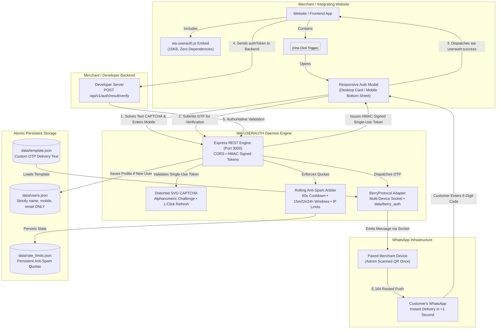

<div align="center">

```
██╗    ██╗ █████╗        ██╗   ██╗███████╗███████╗██████╗  █████╗ ██╗   ██╗████████╗██╗  ██╗
██║    ██║██╔══██╗       ██║   ██║██╔════╝██╔════╝██╔══██╗██╔══██╗██║   ██║╚══██╔══╝██║  ██║
██║ █╗ ██║███████║ █████╗██║   ██║███████╗█████╗  ██████╔╝███████║██║   ██║   ██║   ███████║
██║███╗██║██╔══██║ ╚════╝██║   ██║╚════██║██╔══╝  ██╔══██╗██╔══██║██║   ██║   ██║   ██╔══██║
╚███╔███╔╝██║  ██║       ╚██████╔╝███████║███████╗██║  ██║██║  ██║╚██████╔╝   ██║   ██║  ██║
 ╚══╝╚══╝ ╚═╝  ╚═╝        ╚═════╝ ╚══════╝╚══════╝╚═╝  ╚═╝╚═╝  ╚═╝ ╚═════╝    ╚═╝   ╚═╝  ╚═╝
```

# 💬 WA-USERAUTH V1

### The Sovereign, Self-Hosted WhatsApp OTP Authentication Service for Developers
**$0 SMS Fees Forever • 1-Script & 1-Button Integration • Strict 3-Field JSON Storage • Multi-Device WhatsApp Socket • 240+ Global Countries**

<br/>

[](https://nodejs.org)
[](#)
[](#)
[](#)
[](#)
[](#)
[-success?style=for-the-badge&logo=vitest&logoColor=white)](#)
[](#)

<br/>

<p align="center">
  <a href="#-the-problem-stop-paying-sms-gateways">Why WA-USERAUTH?</a> •
  <a href="#-architecture-at-a-glance">Architecture</a> •
  <a href="#-key-features--superpowers">Superpowers</a> •
  <a href="#-quickstart-in-60-seconds">Quickstart</a> •
  <a href="#-developer-integration-guide">Developer Integration</a> •
  <a href="#-strict-architectural-invariants">Strict Invariants</a> •
  <a href="#-admin-control-center">Admin Panel</a> •
  <a href="#-rest-api-reference">REST API</a> •
  <a href="#-automated-test-suite">Tests</a>
</p>

---

</div>

<br/>

## 💡 The Problem: Stop Paying SMS Gateways for OTP Verifications

Traditional authentication providers (Twilio, Firebase SMS, Auth0, Clerk, AWS SNS) charge extortionate fees per SMS, suffer international delivery failures, and lock your customer data inside proprietary third-party clouds:

| Comparison Metric | Traditional SMS / SaaS Auth (Twilio / Firebase / Auth0) | ⚡ WA-USERAUTH (Self-Hosted Sovereign) |
| :--- | :--- | :--- |
| **Delivery Cost** | **$0.02 to $0.15 per SMS** (Tens of thousands in monthly bills) | **$0.00 (Zero Delivery Fees Forever)** |
| **International Rates** | Astronomical roaming / country surcharges | **Free Global Delivery** across all 240+ countries |
| **Phishing & SIM Swapping** | High vulnerability (SMS interception, network spoofing) | **Zero SIM Spoofing** (Delivered directly into active WhatsApp session) |
| **Integration Overhead** | Heavy SDK dependencies, redirects, OAuth complexity | **1 Script Tag + 1 HTML Button** |
| **User Data Ownership** | Locked in vendor databases with proprietary schemas | **100% Sovereign File (`data/users.json`)** strictly `{name, mobile, email}` |
| **Bot & Spam Protection** | Costly third-party CAPTCHA add-ons | **Built-in Distorted Visual Alphanumeric CAPTCHA** with single-use replay guard |
| **Rate Limit Persistence** | Requires complex external Redis instances | **Native Atomic Store (`data/rate_limits.json`)** surviving server restarts |
| **Template Customization** | Strict carrier DLT pre-approval hurdles | **Live Admin Template Editor** with custom emojis and dynamic `{{otp}}` |
| **Vendor Dependency** | Complete SaaS platform lock-in | **Single Node.js Daemon** with persistent multi-device WhatsApp socket |

<br/>

---

## 🏗️ Architecture at a Glance

WA-USERAUTH embeds directly into any website or application via a lightweight standalone script (`wa-userauth.js`), communicates over a secure REST API with rolling rate limiters and visual CAPTCHA guards, and delivers OTP messages through an autonomous multi-device WhatsApp socket powered by Berry Protocol:



<br/>

---

## 🚀 Key Features & Superpowers

### 1. ⚡ 0% SMS Costs Forever
Ditch monthly SMS gateway bills. Messages dispatch directly over your paired WhatsApp multi-device connection for zero incremental delivery cost per user.

### 2. 🖱️ Universal One-Script & One-Button Integration
Integrate on any platform (plain HTML, React, Next.js, Vue, WordPress, Shopify, PHP) with just:
```html
<script src="http://localhost:3000/wa-userauth.js" data-app-key="app_default_demo"></script>
<button data-wa-userauth>Login with WhatsApp</button>
```

### 3. 🛡️ 3-Field Invariant User Store (`data/users.json`)
Data architecture enforced with strict mathematical invariants:
- **Exactly one database file**: `data/users.json`.
- **Strictly and only 3 fields**: `name`, `mobile`, `email`.
- **Zero bloat**: Extra fields like `id`, `role`, `password`, `created_at` are rejected with errors.
- **Atomic updates**: Written via temporary `.tmp` buffers and atomic OS renames with automatic corrupted-file backup preservation.

### 4. 🌍 Country Picker (240+ Countries & Territories)
- Comprehensive dataset covering every single country and territory worldwide with WhatsApp connectivity (+1 to +998).
- **In-Modal Full-Height Sheet (`.wa-country-view`)**: Eliminates overflow clipping glitches entirely.
- **Instant Search**: Type country name, ISO code, or dialing code with or without `+` (e.g. `India`, `IN`, `91`, or `+91`).
- Custom dark scrollbars with smooth touch scrolling and `Escape` key dismissal.

### 5. 🧩 Alphanumeric CAPTCHA
- **Human-Verifiable SVG Image**: 5 distinct alphanumeric characters (`23456789ABCDEFGHJKLMNPQRSTUVWXYZ`, excluding confusing characters `0, O, 1, I, l`).
- **Cryptographic Distortion**: Randomized character rotations (-18° to +18°), curved Bezier noise interference lines, and random noise dots.
- **1-Click Instant Refresh**: Generates fresh challenges without page reloads.
- **Single-Use Replay Protection**: Challenges expire after 5 minutes and are destroyed upon use.

### 6. ⏱️ Rate Limiting
- **Cooldown Interval**: 60-second cooldown between sends to the same E.164 number.
- **Rolling Quotas**: Max 3 sends per 15 min, max 5 per 1 hr, max 10 per 24 hr.
- **IP Protection**: Max 30 attempts per 15 minutes per IP address.
- **State Persistence**: Serialized into `data/rate_limits.json` so limits survive application restarts.

### 7. 📱 Persistent WhatsApp Device Session (Berry Protocol)
- Headless multi-device socket keeps pairing alive across server restarts (`data/berry_auth/`).
- Auto-reconnect loop with exponential backoff.
- Zero Chrome/Puppeteer heavy browser requirements.

### 8. ⚡ Real-Time Admin Control Center with Instant Pairing Auto-Sync
- Live pairing via Server-Sent Events (`GET /api/v1/admin/stream`) and 2-second continuous sync.
- Scanning QR automatically transitions UI to active device status (`✅ +918796266491 Active & Ready for OTP Dispatch`) with zero manual page refreshes.
- Admin-customizable OTP message template with `{{otp}}` placeholder and real-time WhatsApp bubble preview.

### 9. 🔐 Cryptographic Server-to-Server Result Tokens
- Frontend receives short-lived, single-use, HMAC-SHA256 signed `authToken`.
- Developers verify tokens through authoritative backend-to-backend API calls (`POST /api/v1/auth/result/verify`).
- 
<br/>

---

## ⚡ Quickstart in 60 Seconds

### Prerequisites
- Node.js `v20.0.0` or higher (`v22+ LTS` recommended)
- npm `v10+`

### 1. Clone & Install
```bash
git clone https://github.com/gxurav1710/WA-USERAUTH.git
cd WA-USERAUTH
npm install
```

### 2. Configure Environment
```bash
cp .env.example .env
```
Default configuration works out of the box for local development:
```env
PORT=3000
ADMIN_PASSWORD=admin_password_123
ALLOWED_APPS=app_default_demo:secret_default_demo_key_998877
CAPTCHA_PROVIDER=mock
```

### 3. Run the Service
```bash
# Start server in production mode
npm start

# Or start in watch/development mode
npm run dev
```

### 4. Open Control Center & Pair WhatsApp
1. Open your browser at **`http://localhost:3000/admin/`**.
2. Enter the administrator password (default: `admin_password_123`).
3. Scan the QR code using WhatsApp on your phone (**Linked Devices → Link a Device**).
4. The admin panel automatically updates to **CONNECTED** in real time!

### 5. Test Live Demo
Navigate to **`http://localhost:3000/demo/`** to test the complete user login flow.

<br/>

---

## 💻 Developer Integration Guide

### Method A: Declarative Zero-JS Button

Add one script tag and tag any HTML button with `data-wa-userauth`:

```html
<!-- 1. Include Universal Client Script -->
<script 
  src="http://localhost:3000/wa-userauth.js" 
  data-app-key="app_default_demo">
</script>

<!-- 2. Add Trigger Button -->
<button data-wa-userauth>
  🔐 Login with WhatsApp
</button>

<!-- 3. Listen for Authentication Outcome -->
<script>
  window.addEventListener('wa-userauth:success', (event) => {
    const { user, authToken } = event.detail;
    console.log('Authenticated User:', user.name, user.mobile, user.email);

    // Send authToken to your backend for authoritative session creation
    fetch('/api/login', {
      method: 'POST',
      headers: { 'Content-Type': 'application/json' },
      body: JSON.stringify({ authToken })
    });
  });

  window.addEventListener('wa-userauth:error', (event) => {
    console.error('Login Failed:', event.detail.message);
  });
</script>
```

---

### Method B: Programmatic JavaScript API

Ideal for Single Page Applications (React, Next.js, Vue, Angular, Svelte):

```javascript
window.WAUserAuth.open({
  appKey: 'app_default_demo',
  apiUrl: 'http://localhost:3000',
  onSuccess: async (data) => {
    console.log('Success:', data.user);
    // data.authToken is a single-use token to verify on your backend
    await verifyWithBackend(data.authToken);
  },
  onError: (err) => {
    console.error('Auth error:', err.message);
  },
  onClose: (detail) => {
    console.log('Modal dismissed:', detail.reason);
  }
});
```

---

### Method C: Authoritative Backend Token Verification

> [!IMPORTANT]
> Frontend DOM events are for UI updates only. To protect protected resources, your backend server MUST verify the `authToken` with WA-USERAUTH.

#### Node.js / Express Example:
```javascript
app.post('/api/login', async (req, res) => {
  const { authToken } = req.body;

  const response = await fetch('http://localhost:3000/api/v1/auth/result/verify', {
    method: 'POST',
    headers: { 'Content-Type': 'application/json' },
    body: JSON.stringify({
      authToken,
      appKey: 'app_default_demo',
      appSecret: 'secret_default_demo_key_998877'
    })
  });

  const result = await response.json();

  if (!result.success) {
    return res.status(401).json({ error: 'Invalid or expired auth token' });
  }

  // Authoritative verified identity
  const { name, mobile, email } = result.user;
  req.session.user = { name, mobile, email };

  return res.json({ success: true, user: req.session.user });
});
```

#### Python / FastAPI Example:
```python
import httpx
from fastapi import FastAPI, HTTPException

app = FastAPI()

@app.post("/api/login")
async def verify_login(payload: dict):
    auth_token = payload.get("authToken")
    async with httpx.AsyncClient() as client:
        res = await client.post(
            "http://localhost:3000/api/v1/auth/result/verify",
            json={
                "authToken": auth_token,
                "appKey": "app_default_demo",
                "appSecret": "secret_default_demo_key_998877"
            }
        )
    data = res.json()
    if not data.get("success"):
        raise HTTPException(status_code=401, detail="Authentication failed")
    
    user = data["user"] # {"name": "...", "mobile": "+91...", "email": "..."}
    return {"status": "authenticated", "user": user}
```

<br/>

---

## 🔒 Strict Architectural Invariants

### 1. Exactly ONE User Database File
- **Path**: `data/users.json`
- **Schema**: Array of user objects containing **strictly and only 3 fields**:
  ```json
  [
    {
      "name": "Jane Doe",
      "mobile": "+919876543210",
      "email": "jane@example.com"
    }
  ]
  ```
- **Rules**:
  - `mobile` is unique and normalized to E.164.
  - Adding extra properties (such as `id`, `role`, `password`, `created_at`) throws a validation error.
  - Existing profiles are immutable by subsequent logins; stored profiles remain authoritative.

### 2. Multi-Tiered Anti-Spam Rate Limiter
- **Mobile Quota**: 60s cooldown per send, 60s resend cooldown. Rolling quotas: max 3 per 15 min, max 5 per 1 hr, max 10 per 24 hr.
- **IP Quota**: Max 30 requests per 15 min per IP.
- **Persistence**: Saved to `data/rate_limits.json` on each request using in-memory mutex locking to prevent race conditions.

### 3. Alphanumeric Visual CAPTCHA
- Distorted SVG challenge must be solved before an initial OTP or resend is dispatched.
- Stored in memory with a 5-minute TTL. Replaying an already-consumed challenge ID is rejected.

<br/>

---

## 📱 Admin Control Center

Accessible at **`http://localhost:3000/admin/`**:

- **Real-Time WhatsApp Status**: Live connection status (`DISCONNECTED`, `CONNECTING`, `QR_READY`, `CONNECTED`) streamed via SSE.
- **Device Pairing**: Dynamic SVG QR code refreshed automatically; turns into verified device badge on scan.
- **Message Template Editor**: Live WhatsApp bubble preview with configurable copy and protected `{{otp}}` tag.
- **Registered User Directory**: Searchable table viewing all verified user profiles in `data/users.json`.

<br/>

---

## 📖 Complete REST API Reference

| Method | Endpoint | Auth | Description |
| :--- | :--- | :--- | :--- |
| `GET` | `/health` | Public | Service health & WhatsApp connection status |
| `GET` | `/api/v1/auth/captcha/new` | Public | Generates a fresh distorted SVG alphanumeric CAPTCHA challenge |
| `POST` | `/api/v1/auth/check-user` | Client | Checks if a mobile number exists in `data/users.json` |
| `POST` | `/api/v1/auth/otp/send` | Client | Dispatches 6-digit OTP via WhatsApp with CAPTCHA validation |
| `POST` | `/api/v1/auth/otp/verify` | Client | Verifies submitted OTP code and returns single-use `authToken` |
| `POST` | `/api/v1/auth/result/verify` | Merchant Secret | Authoritative server-to-server verification of `authToken` |
| `GET` | `/api/v1/admin/stream` | Admin Token | Server-Sent Events stream for instant WhatsApp pairing & status updates |
| `GET` | `/api/v1/admin/status` | Admin Token | Metrics on WhatsApp socket, registered users, and system uptime |
| `GET` | `/api/v1/admin/qr` | Admin Token | Fetches current pairing QR code or connected device info |
| `POST` | `/api/v1/admin/pair/reconnect` | Admin Token | Forces WhatsApp socket reconnection and issues fresh QR |
| `POST` | `/api/v1/admin/pair/disconnect` | Admin Token | Disconnects device and purges stored session tokens |
| `GET` | `/api/v1/admin/template` | Admin Token | Retrieves custom OTP delivery message template |
| `POST` | `/api/v1/admin/template` | Admin Token | Updates custom message template (validates `{{otp}}`) |
| `POST` | `/api/v1/admin/template/reset`| Admin Token | Restores default OTP delivery template |
| `GET` | `/api/v1/admin/users` | Admin Token | Retrieves all records from `data/users.json` |

<br/>

---

## 🧪 Automated Test Suite

WA-USERAUTH includes a regression test suite validating all security guardrails, rate limits, templates, and storage invariants:

```bash
npm test
```

### Test Coverage Highlights:
- **Strict 3-Field User Records**: Verifies exact schema enforcement, rejection of prohibited fields (`id`, `role`, `timestamps`), atomic file updates, and corrupted JSON backup preservation.
- **CAPTCHA Engine**: Challenge creation, SVG distortion, case-insensitive verification, replay prevention, and failure in production without keys.
- **Rate Limiting Engine**: 60s cooldowns, rolling 1h/24h limits, IP quotas, parallel request serialization, and disk persistence across restarts.
- **Template Validator**: Validates single `{{otp}}` placeholder, unicode/emoji handling, max length limits, and persistence.
- **End-to-End API Integration**: Full simulated customer registration, existing login, and backend token verification.

```
ℹ tests 40
ℹ suites 6
ℹ pass 40
ℹ fail 0
ℹ duration_ms 577ms
```

<br/>

---
